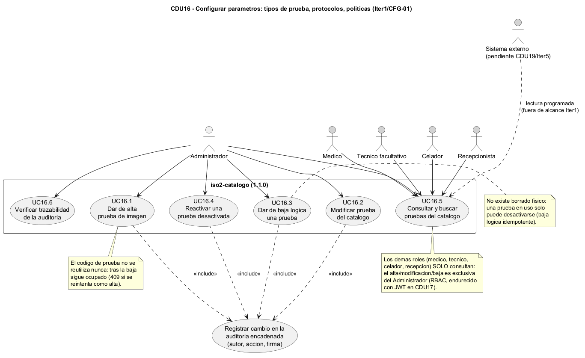
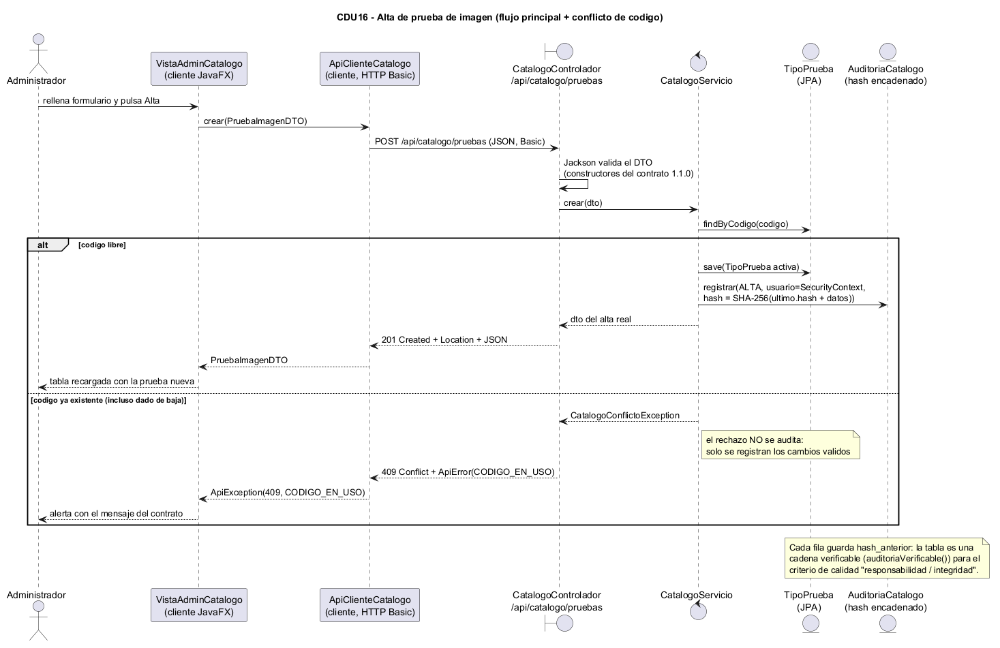
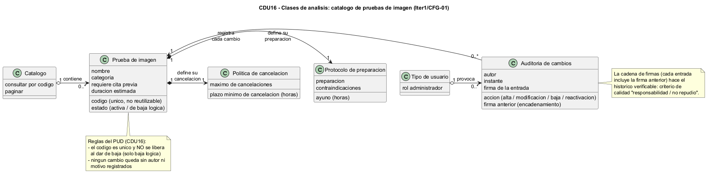
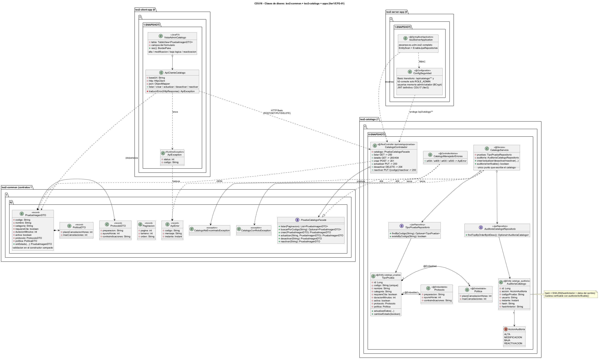

# Modelo de Iter1 / CFG-01 (CDU16)

Diagramas de la CDU16 "Configurar parametros: tipos de prueba, protocolos, politicas"
(Iteracion 1, configuracion CFG-01). Igual que en el resto de iteraciones, las fuentes
editables del modelo son los ficheros PlantUML (`.puml`) de este directorio; los `.png`
incrustados mas abajo se renderizan a partir de esas fuentes con `tools/plantuml.jar`
(decision D31, que descarta la exportacion a StarUML de D18).

## Fuentes PlantUML (lo que versiona el proyecto)

| Fichero | Diagrama | Que cubre |
|---|---|---|
| `cdu16-casos-uso.puml` | Casos de uso | Administrador + roles de rol (solo consulta): UC16.1-UC16.6 dentro del sistema y UC7 de auditoria encadenada fuera de la frontera, con `<<include>>` desde los UC de escritura |
| `cdu16-secuencia.puml` | Secuencia | Alta de prueba: flujo principal + alt por conflicto de codigo (409) |
| `cdu16-clases-analisis.puml` | Clases de analisis | Conceptos del dominio: prueba, protocolo, politica, auditoria encadenada |
| `cdu16-clases-diseno.puml` | Clases de diseno | Implementacion real 1.1.0: fachada + DTOs, entidad JPA + embebidos, repositorios, servicio, controlador, advice, cliente JavaFX |

Convencion de las fuentes: ASCII en los comentarios (evitar acentos/emes en lineas
`'`) para que no haya ambiguedad de codificacion; UTF-8 para el resto.

## Diagramas (clic sobre la imagen para abrirla a tamano completo)

### Casos de uso

<a href="cdu16-casos-uso.png"></a>

### Secuencia

<a href="cdu16-secuencia.png"></a>

### Clases de analisis

<a href="cdu16-clases-analisis.png"></a>

### Clases de diseno

<a href="cdu16-clases-diseno.png"></a>

## Visualizar / exportar a imagen

Los `.png` de arriba estan versionados en este directorio; para regenerarlos tras tocar
un `.puml`, desde la raiz del repositorio:

```text
java -jar tools/plantuml.jar -tpng docs/modelo/iter01/*.puml
```

(`tools/plantuml.jar` se descarga de plantuml.com y no se versiona, ver D31; si no hay
Graphviz instalado, anadir `-Playout smetana`.)
La sintaxis es la estandar de PlantUML (`@startuml`/`@enduml`); no usa macros ni
includes entre ficheros, asi que cada diagrama se procesa por separado.

## Artefactos de entrega (D31)

Los artefactos de modelado de CFG-01 son los `.puml` (fuente, item de configuracion D25)
y los `.png` renderizados con `tools/plantuml.jar`, ambos en este directorio. La
exportacion a StarUML prevista en D18 no se hizo y queda descartada (D31): no existe
ningun proyecto `.staruml` y el trabajo se ha hecho integramente con PlantUML.

## Relacion con el codigo

El diagrama de diseno describe el codigo ya implementado en Iter1:

- `iso2-common` 1.1.0-SNAPSHOT: `es.uclm.iso2.common.catalogo.PruebaCatalogoFacade`
  (DTOs anidados con validacion en el constructor) y `es.uclm.iso2.common.shared`
  (`Paginacion`, `ApiError`).
- `iso2-catalogo` 1.1.0-SNAPSHOT: dominio (`TipoPrueba`, `Protocolo`, `Politica`,
  `AuditoriaCatalogo`), repositorios, `CatalogoServicio` y capa web
  (`CatalogoControlador`, `CatalogoManejadorErrores`).
- `iso2-server-app` 0.1.1-SNAPSHOT: ensamblado + `ConfigSeguridad` (RBAC transitorio).
- `iso2-client-app` 0.1.1-SNAPSHOT: `ApiClienteCatalogo`/`ApiException` +
  `VistaAdminCatalogo`.

Si el codigo cambia tras los TC humanos de CDU16 (D28), actualizar primero el `.puml`
y volver a renderizar el `.png` con `tools/plantuml.jar`.
