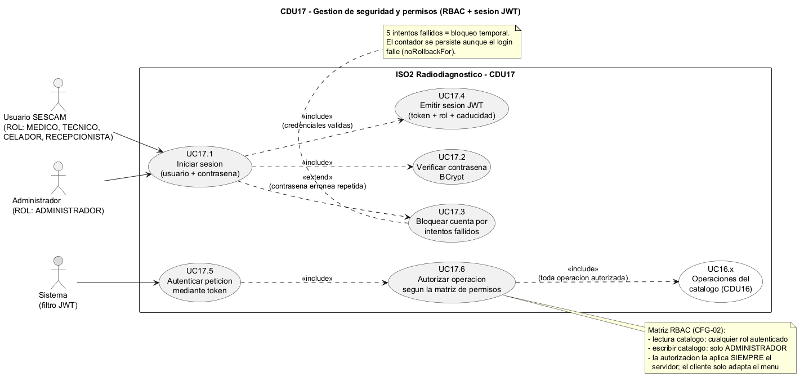
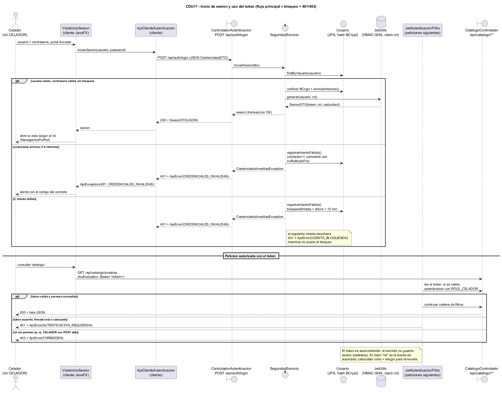
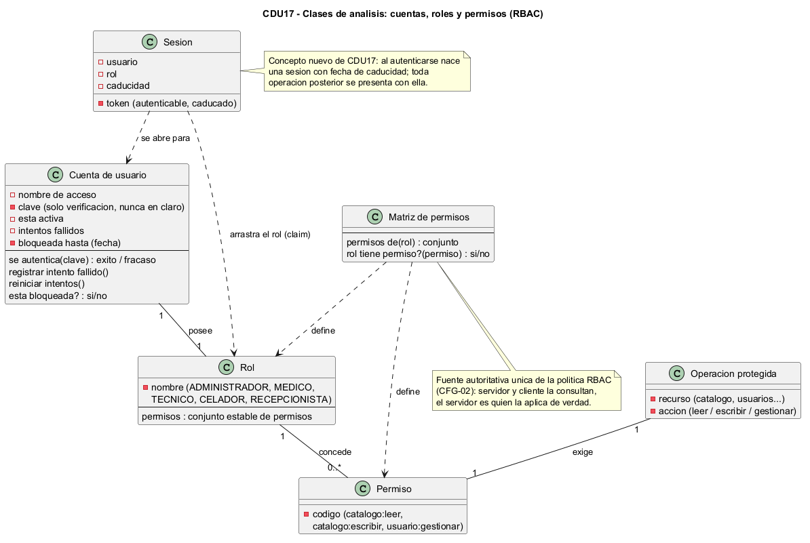
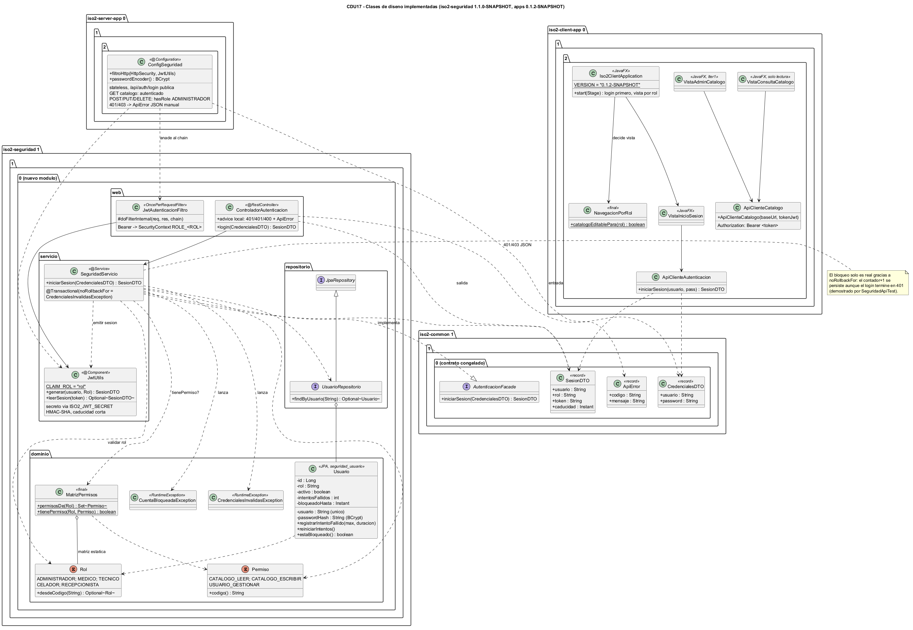

# Modelo de Iter2 / CFG-02 (CDU17)

Diagramas de la CDU17 "Gestion de seguridad y permisos" (Iteracion 2, configuracion
CFG-02: RBAC con 5 roles + sesion JWT + bloqueo de cuentas). Igual que en el resto de
iteraciones, las fuentes editables del modelo son los ficheros PlantUML (`.puml`) de
este directorio; los `.png` incrustados mas abajo se renderizan a partir de esas fuentes
con `tools/plantuml.jar` (decision D31, que descarta la exportacion a StarUML de D18).

## Fuentes PlantUML (lo que versiona el proyecto)

| Fichero | Diagrama | Que cubre |
|---|---|---|
| `cdu17-casos-uso.puml` | Casos de uso | Login (UC17.1) con `<<include>>` de verificacion BCrypt y emision JWT, `<<extend>>` de bloqueo por intentos, y autenticacion/autorizacion silenciosa del filtro (UC17.5-UC17.6) encadenada a los UC16 del catalogo |
| `cdu17-secuencia.puml` | Secuencia | Inicio de sesion (flujo principal + credenciales invalidas + 5. intento con bloqueo) y despues una peticion con Bearer a traves de `JwtAutenticacionFiltro` (200 / 401 / 403 con `ApiError`) |
| `cdu17-clases-analisis.puml` | Clases de analisis | Conceptos del dominio: cuenta con bloqueo temporal, rol, permiso, matriz de permisos, sesion, operacion protegida |
| `cdu17-clases-diseno.puml` | Clases de diseno | Implementacion real: `iso2-seguridad` 1.1.0-SNAPSHOT (dominio/repositorio/servicio/web), `ConfigSeguridad` del server-app y capa API+UI del client-app 0.1.2-SNAPSHOT |

Convencion de las fuentes: ASCII puro en comentarios y etiquetas de PlantUML (sin
tildes ni emes quenas acentuadas: se escriben "contrasena", "Queda", etc. con
`'`) para que no haya ambiguedad de codificacion; UTF-8 para el resto.

## Diagramas (clic sobre la imagen para abrirla a tamano completo)

### Casos de uso

<a href="cdu17-casos-uso.png"></a>

### Secuencia

<a href="cdu17-secuencia.png"></a>

### Clases de analisis

<a href="cdu17-clases-analisis.png"></a>

### Clases de diseno

<a href="cdu17-clases-diseno.png"></a>

## Visualizar / exportar a imagen

Los `.png` de arriba estan versionados en este directorio; para regenerarlos tras tocar
un `.puml`, desde la raiz del repositorio:

```text
java -jar tools/plantuml.jar -tpng docs/modelo/iter02/*.puml
```

(`tools/plantuml.jar` se descarga de plantuml.com y no se versiona, ver D31; si no hay
Graphviz instalado, anadir `-Playout smetana`.)
La sintaxis es la estandar de PlantUML (`@startuml`/`@enduml`); no usa macros ni
includes entre ficheros, asi que cada diagrama se procesa por separado.
Los cuatro fuentes de este directorio se comprobaron renderizando a PNG sin errores.

## Artefactos de entrega (D31)

Los artefactos de modelado de CFG-02 son los `.puml` (fuente, item de configuracion D25)
y los `.png` renderizados con `tools/plantuml.jar`, ambos en este directorio. La
exportacion a StarUML prevista en D18 no se hizo y queda descartada (D31): no existe
ningun proyecto `.staruml` y el trabajo se ha hecho integramente con PlantUML.

## Relacion con el codigo

El diagrama de diseno describe el codigo ya implementado en Iter2:

- `iso2-common` 1.1.0-SNAPSHOT: `es.uclm.iso2.common.seguridad.AutenticacionFacade`
  (fachada congelada + `CredencialesDTO`/`SesionDTO`) y `shared.ApiError`.
- `iso2-seguridad` 1.1.0-SNAPSHOT (modulo nuevo de CFG-02): dominio (`Rol`, `Permiso`,
  `MatrizPermisos`, `Usuario` JPA con bloqueo, excepciones), `UsuarioRepositorio`,
  `SeguridadServicio` (con `noRollbackFor` para que el bloqueo persista), `JwtUtils`
  y capa web (`ControladorAutenticacion`, `JwtAutenticacionFiltro`).
- `iso2-server-app` 0.1.2-SNAPSHOT: `ConfigSeguridad` (chain stateless + matriz RBAC
  por endpoint + 401/403 con `ApiError`), `V1.2.0__cdu17_seguridad.sql` (6 cuentas
  BCrypt sembradas) y `application.yml` con `ISO2_JWT_SECRET` por entorno.
- `iso2-client-app` 0.1.2-SNAPSHOT: `ApiClienteAutenticacion`, `ApiClienteCatalogo`
  (Bearer), `NavegacionPorRol`, `VistaInicioSesion`, `VistaConsultaCatalogo` y
  arranque reencadenado en `Iso2ClientApplication`.

Si el codigo cambia tras los TC humanos de CDU17 (D28), actualizar primero el `.puml`
y volver a renderizar el `.png` con `tools/plantuml.jar`.
