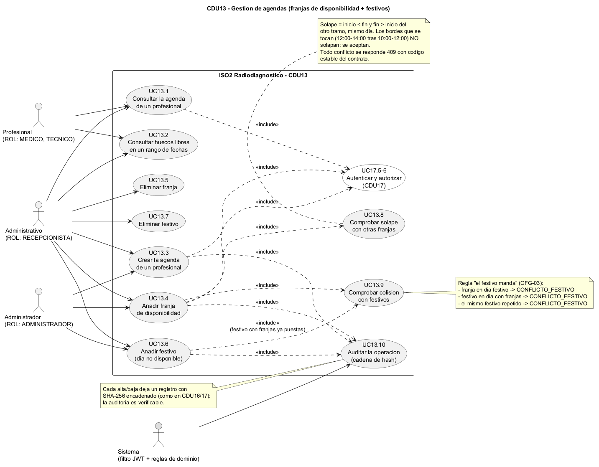
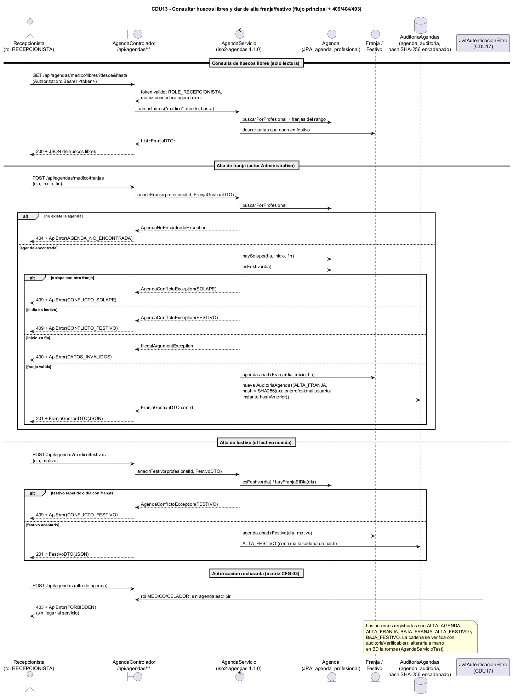
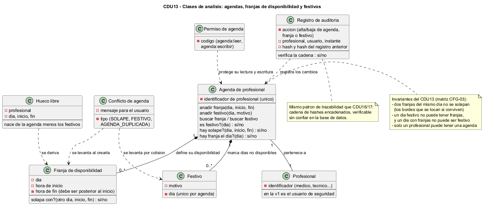
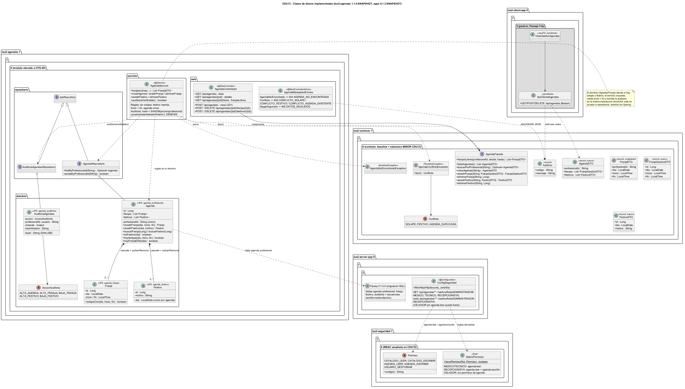

# Modelo de Iter3 / CFG-03 (CDU13)

Diagramas de la CDU13 "Gestion de agendas de medicos y tecnicos" (Iteracion 3,
configuracion CFG-03: agendas con franjas de disponibilidad sin solapes, festivos
que mandan sobre las franjas, RBAC ampliado con `agenda:leer`/`agenda:escribir` y
auditoria encadenada). Igual que en el resto de iteraciones, las fuentes editables
del modelo son los ficheros PlantUML (`.puml`) de este directorio; los `.png`
incrustados mas abajo se renderizan a partir de esas fuentes con `tools/plantuml.jar`
(decision D31, que descarta la exportacion a StarUML de D18).

## Fuentes PlantUML (lo que versiona el proyecto)

| Fichero | Diagrama | Que cubre |
|---|---|---|
| `cdu13-casos-uso.puml` | Casos de uso | Consulta de agenda y huecos libres (UC13.1-2), alta/baja de franjas y festivos (UC13.3-7), `<<include>>` de las comprobaciones de solape y festivo (UC13.8-9) y de la auditoria encadenada (UC13.10), todo `<<include>>` en la autenticacion/autorizacion CDU17 |
| `cdu13-secuencia.puml` | Secuencia | `GET /api/agendas/{pid}/libres` (200), alta de franja con sus ramas 404/409 SOLAPE/409 FESTIVO/400, alta de festivo con "el festivo manda" (409 en ambos sentidos) y el 403 de la matriz sin llegar al servicio |
| `cdu13-clases-analisis.puml` | Clases de analisis | Conceptos del dominio: agenda de profesional, franja de disponibilidad, festivo, hueco libre, conflicto (SOLAPE/FESTIVO/AGENDA_DUPLICADA), registro de auditoria y permiso de agenda; invariantes del CDU |
| `cdu13-clases-diseno.puml` | Clases de diseno | Implementacion real: contrato `AgendaFacade` 1.1.0 (baseline congelado + records nuevos), `iso2-agendas` 1.1.0-SNAPSHOT (dominio/repositorio/servicio/web), RBAC ampliado en `iso2-seguridad`, `ConfigSeguridad` 0.1.3 y la parte de cliente pendiente de Prompt 11b |

Convencion de las fuentes: ASCII puro en comentarios y etiquetas de PlantUML (sin
tildes ni emes quenas acentuadas: se escriben "contrasena", "Queda", etc. con
`'`) para que no haya ambiguedad de codificacion; UTF-8 para el resto.

## Diagramas (clic sobre la imagen para abrirla a tamano completo)

### Casos de uso

<a href="cdu13-casos-uso.png"></a>

### Secuencia

<a href="cdu13-secuencia.png"></a>

### Clases de analisis

<a href="cdu13-clases-analisis.png"></a>

### Clases de diseno

<a href="cdu13-clases-diseno.png"></a>

## Visualizar / exportar a imagen

Los `.png` de arriba estan versionados en este directorio; para regenerarlos tras tocar
un `.puml`, desde la raiz del repositorio:

```text
java -jar tools/plantuml.jar -tpng docs/modelo/iter03/*.puml
```

(`tools/plantuml.jar` se descarga de plantuml.com y no se versiona, ver D31; si no hay
Graphviz instalado, anadir `-Playout smetana`.)
La sintaxis es la estandar de PlantUML (`@startuml`/`@enduml`); no usa macros ni
includes entre ficheros, asi que cada diagrama se procesa por separado.
Los cuatro fuentes de este directorio se comprobaron renderizando a PNG sin errores
(PlantUML + smetana, prompts 11 y 11d).

## Artefactos de entrega (D31)

Los artefactos de modelado de CFG-03 son los `.puml` (fuente, item de configuracion D25)
y los `.png` renderizados con `tools/plantuml.jar`, ambos en este directorio. La
exportacion a StarUML prevista en D18 no se hizo y queda descartada (D31): no existe
ningun proyecto `.staruml` y el trabajo se ha hecho integramente con PlantUML.

## Relacion con el codigo

El diagrama de diseno describe el codigo ya implementado en la parte servidora
de Iter3:

- `iso2-common` 1.1.0-SNAPSHOT: `es.uclm.iso2.common.agendas.AgendaFacade`
  (baseline congelado `franjasLibres`/`FranjaDTO` + metodos MINOR de gestion con
  `AgendaDTO`/`FranjaGestionDTO`/`FestivoDTO`) y las excepciones
  `AgendaNoEncontradoException` y `AgendaConflictoException` (enum `Conflicto`).
- `iso2-agendas` 1.1.0-SNAPSHOT (elevado de baseline a CDU en CFG-03): dominio
  (`Agenda`, `Franja` con `solapaCon`, `Festivo`, `AuditoriaAgendas` con cadena
  SHA-256), repositorios, `AgendaServicio` (reglas de solape/festivo/inicio<fin,
  semilla de auditoria GENESIS y `auditoriaVerificable()`) y capa web
  (`AgendaControlador` en `/api/agendas` + `AgendaManejadorErrores` con codigos
  404/409/400 estables).
- `iso2-seguridad` 1.1.0-SNAPSHOT (ampliado): `Permiso` anade `AGENDA_LEER` y
  `AGENDA_ESCRIBIR`; `MatrizPermisos` concede lectura a MEDICO/TECNICO/RECEPCIONISTA
  y escritura a RECEPCIONISTA (ADMINISTRADOR tiene todo por `allOf`).
- `iso2-server-app` 0.1.3-SNAPSHOT: `ConfigSeguridad` con las reglas de
  `/api/agendas/**` derivadas de la matriz, `V1.3.0__cdu13_agendas.sql` (5 tablas
  `agenda_*` + indices + semilla de desarrollo para medico y tecnico) y
  `AgendasApiTest` (RBAC + 409 solape/festivo/duplicada por HTTP).
- `iso2-client-app` 0.1.3-SNAPSHOT (pendiente, Prompt 11b): `ApiClienteAgendas` y
  `VistaGestionAgendas` con Bearer; el diagrama de diseno las marca en gris.

Tests tecnicos de esta CDU: `AgendaServicioTest` (14 casos: reglas, conflictos,
auditoria verificable y rotura por manipulacion), `ArquitecturaAgendasTest`
(frontera ArchUnit de CFG-03) y `AgendasApiTest` (gate HTTP). Los TC funcionales
humanos de CDU13 los ejecuta Ismael (D28) contra la semilla de desarrollo.

Si el codigo cambia tras los TC humanos de CDU13 (D28), actualizar primero el
`.puml` y volver a renderizar el `.png` con `tools/plantuml.jar`.
