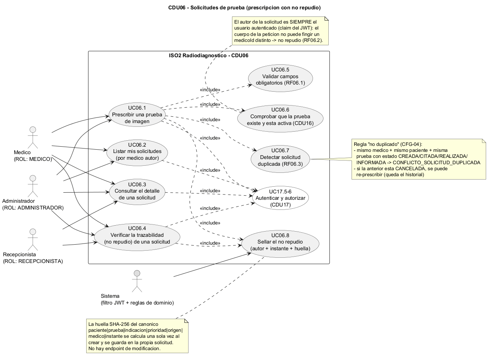
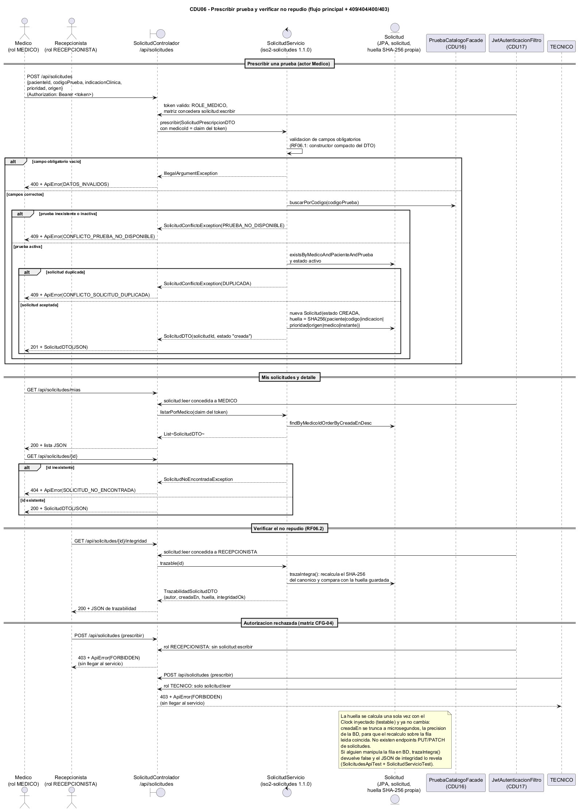
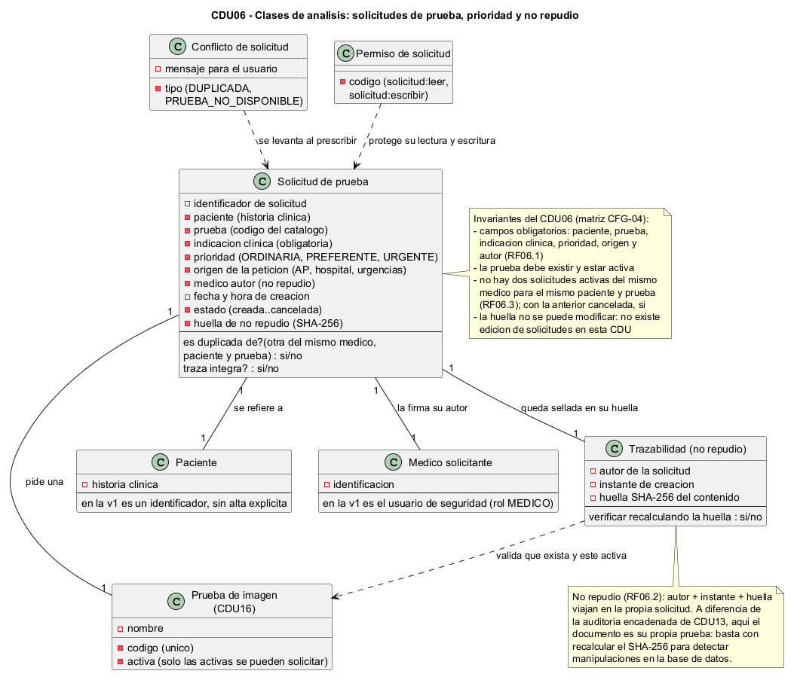
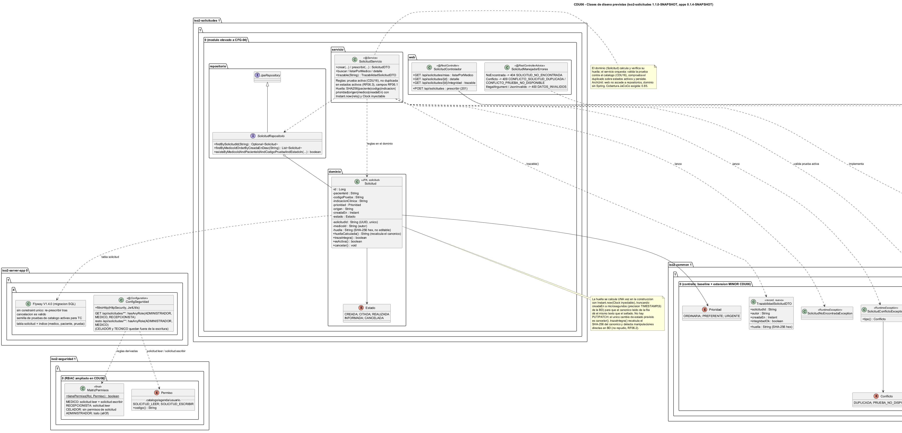

# Modelo de Iter4 / CFG-04 (CDU06)

Diagramas de la CDU06 "Solicitudes de prueba desde Atencion Primaria" (Iteracion 4,
configuracion CFG-04: prescripcion medica con campos obligatorios, validacion contra
el catalogo de CDU16, anti-duplicado, no repudio con huella SHA-256 y RBAC ampliado
con `solicitud:leer`/`solicitud:escribir`). Las fuentes editables del modelo son los
ficheros PlantUML (`.puml`) de este directorio; los `.png` incrustados mas abajo se
renderizan a partir de esas fuentes con `tools/plantuml.jar` (decision D31).

> **Iter4 es diseño-primero** (registrado en el issue #30): estos cuatro diagramas se
> commitearon ANTES de escribir el codigo de CDU06 y actuan de contrato interno:
> definen paquetes, firmas de metodos, codigos HTTP y reglas de dominio que luego
> implementan `iso2-common`, `iso2-solicitudes`, `iso2-seguridad` y `iso2-server-app`.
> Si un test de caminos criticos humano (D28) o el compilador obligan a cambiar una
> firma, se edita primero el `.puml` y se commitea junto al cambio.

## Fuentes PlantUML (lo que versiona el proyecto)

| Fichero | Diagrama | Que cubre |
|---|---|---|
| `cdu06-casos-uso.puml` | Casos de uso | Prescripcion de pruebas (UC06.1), listado por medico y detalle (UC06.2-3), verificacion de no repudio (UC06.4), `<<include>>` de la validacion de campos obligatorios (UC06.5), de la prueba activa del catalogo CDU16 (UC06.6), del anti-duplicado (UC06.7) y del sellado de huella (UC06.8), todo `<<include>>` en la autenticacion/autorizacion CDU17 |
| `cdu06-secuencia.puml` | Secuencia | `POST /api/solicitudes` con sus ramas 400 DATOS_INVALIDOS / 409 PRUEBA_NO_DISPONIBLE / 409 DUPLICADA / 201, `GET /api/solicitudes/mias` y `GET /{id}` con su 404, `GET /{id}/integridad` (recalculo de la huella) y los 403 de la matriz para RECEPCIONISTA y TECNICO que intentan escribir |
| `cdu06-clases-analisis.puml` | Clases de analisis | Conceptos del dominio: solicitud de prueba (con prioridad y estado), prueba del catalogo, paciente, medico autor, conflicto (DUPLICADA/PRUEBA_NO_DISPONIBLE), trazabilidad de no repudio y permiso de solicitud; invariantes del CDU |
| `cdu06-clases-diseno.puml` | Clases de diseno | Implementacion prevista: contrato `SolicitudFacade` 1.1.0 (baseline congelado `crear`/`buscar` + metodos MINOR `prescribir`/`listarPorMedico`/`detalle`/`trazable` con records y excepciones nuevos), `iso2-solicitudes` 1.1.0-SNAPSHOT (dominio/repositorio/servicio/web), RBAC ampliado en `iso2-seguridad`, `ConfigSeguridad` 0.1.4, migracion Flyway V1.4.0 y la parte de cliente pendiente |

Convencion de las fuentes: ASCII puro en comentarios y etiquetas de PlantUML (sin
tildes ni emes quenas acentuadas: se escriben "diseno", "autenticacion", etc. con
`'`) para que no haya ambiguedad de codificacion; UTF-8 para el resto.

## Diagramas (clic sobre la imagen para abrirla a tamano completo)

### Casos de uso

<a href="cdu06-casos-uso.png"></a>

### Secuencia

<a href="cdu06-secuencia.png"></a>

### Clases de analisis

<a href="cdu06-clases-analisis.png"></a>

### Clases de diseno

<a href="cdu06-clases-diseno.png"></a>

## Visualizar / exportar a imagen

Los `.png` de arriba estan versionados en este directorio; para regenerarlos tras tocar
un `.puml`, desde la raiz del repositorio:

```text
java -jar tools/plantuml.jar -tpng docs/modelo/iter04/*.puml
```

(`tools/plantuml.jar` se descarga de plantuml.com y no se versiona, ver D31; si no hay
Graphviz instalado, anadir `-Playout smetana`.)
La sintaxis es la estandar de PlantUML (`@startuml`/`@enduml`); no usa macros ni
includes entre ficheros, asi que cada diagrama se procesa por separado.
Los cuatro fuentes de este directorio se comprobaron renderizando a PNG sin errores
(PlantUML + smetana, Iter4).

## Artefactos de entrega (D31)

Los artefactos de modelado de CFG-04 son los `.puml` (fuente, item de configuracion D25)
y los `.png` renderizados con `tools/plantuml.jar`, ambos en este directorio. La
exportacion a StarUML prevista en D18 no se hizo y queda descartada (D31): no existe
ningun proyecto `.staruml` y el trabajo se ha hecho integramente con PlantUML.

## Relacion con el codigo

A diferencia de iteraciones anteriores, el diagrama de diseno describe el codigo
**aun por implementar** en la parte servidora de Iter4 (diseno-primero). Lo que se
compromete a construir:

- `iso2-common` 1.1.0-SNAPSHOT: `es.uclm.iso2.common.solicitudes.SolicitudFacade`
  (baseline 1.0.0 congelado: `crear`/`buscar` con `SolicitudNuevaDTO`/`SolicitudDTO`
  + metodos MINOR `prescribir`/`listarPorMedico`/`detalle`/`trazable` con los records
  nuevos `SolicitudPrescripcionDTO` y `TrazabilidadSolicitudDTO`, el enum `Prioridad`
  y las excepciones `SolicitudNoEncontradaException` y `SolicitudConflictoException`
  con enum anidado `Conflicto`). El constructor compacto de `SolicitudPrescripcionDTO`
  valida los campos obligatorios (RF06.1) como parte del contrato.
- `iso2-solicitudes` 1.1.0-SNAPSHOT (elevado de baseline a CDU en CFG-04, D23): dominio
  (`Solicitud` con enum anidado `Estado`, huella SHA-256 del canonico calculada una vez
  y `trazaIntegra()` que la recalcula), `SolicitudRepositorio`, `SolicitudServicio`
  (reloj `Clock` inyectable, validacion contra `PruebaCatalogoFacade` y anti-duplicado
  sobre estados activos) y capa web (`SolicitudControlador` en `/api/solicitudes` +
  `SolicitudManejadorErrores` con codigos 404/409/400 estables). Cobertura JaCoCo del
  modulo: minimo 0.85 (SOFTWAREQUALITY.md §2.5).
- `iso2-seguridad` 1.1.0-SNAPSHOT (ampliado): `Permiso` anade `SOLICITUD_LEER` y
  `SOLICITUD_ESCRIBIR`; `MatrizPermisos` concede lectura a MEDICO/RECEPCIONISTA y
  escritura solo a MEDICO (ADMINISTRADOR tiene todo por `allOf`; CELADOR y TECNICO
  quedan fuera).
- `iso2-server-app` 0.1.4-SNAPSHOT: `ConfigSeguridad` con las reglas de
  `/api/solicitudes/**` derivadas de la matriz, `V1.4.0__cdu06_solicitudes.sql` (tabla
  `solicitud` + indice, sin constraint unico para permitir re-prescripcion tras
  cancelacion, y semilla de pruebas de catalogo activas para los TC humanos: V1.1.0 no
  sembro catalogo) y `SolicitudesApiTest` (RBAC + 409/404/400 por HTTP).
- `iso2-client-app` 0.1.4-SNAPSHOT (pendiente, parte b): `ApiClienteSolicitudes` y
  `VistaSolicitudesMedico` con Bearer; el diagrama de diseno las marca en gris.

Tests tecnicos previstos de esta CDU: `SolicitudServicioTest` (RF06.1 campo a campo,
duplicado imposible RF06.3, huella e integridad RF06.2 con `Clock` fijo),
`ArquitecturaSolicitudesTest` (frontera ArchUnit de CFG-04) y `SolicitudesApiTest`
(gate HTTP con RBAC). Los TC funcionales humanos de CDU06 los ejecuta Ismael (D28)
contra la semilla de desarrollo.

Si el codigo cambia tras los TC humanos de CDU06 (D28), actualizar primero el
`.puml` y volver a renderizar el `.png` con `tools/plantuml.jar`.
