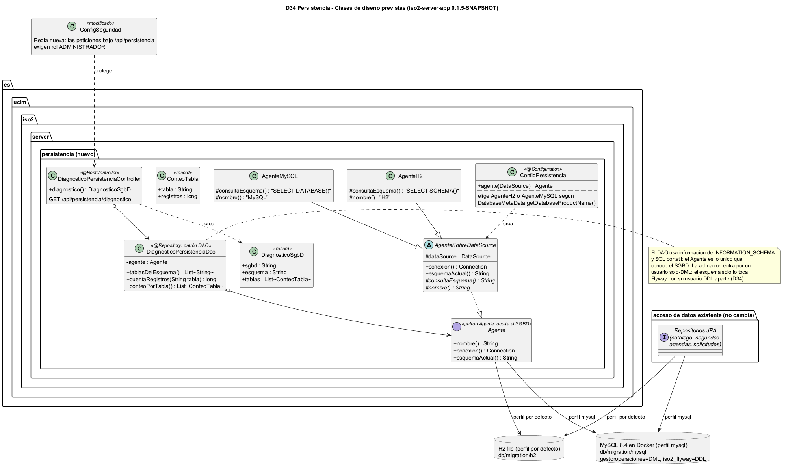
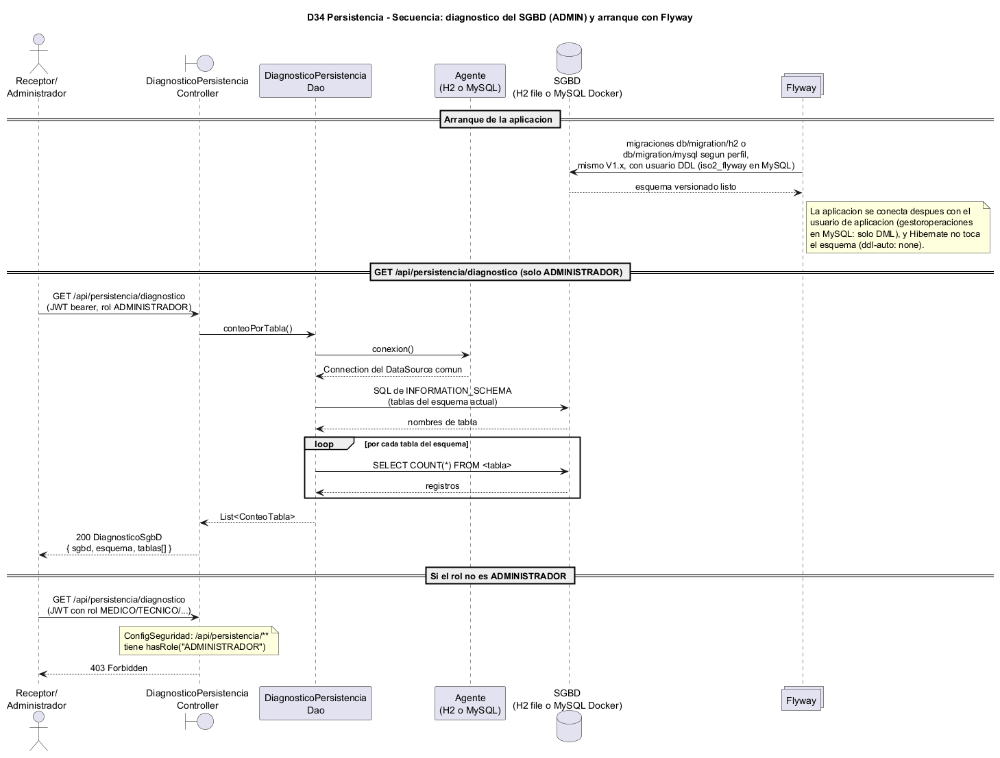

# Modelo de Iter5 / CFG-05 (D34 persistencia + CDU12)

Modelo de la Iteracion 5. Reune dos partes:

1. **D34 · capa de persistencia MySQL/DAO/Agente** (issue #34): infraestructura
   prometida en la decision D34 — MySQL 8.4 en Docker con phpMyAdmin, migraciones
   Flyway dobles por carpeta (`db/migration/h2` y `db/migration/mysql`, elegidas
   por perfil activo), usuarios con privilegios separados (`gestoroperaciones`
   solo DML, `iso2_flyway` DDL) y una capa nueva de acceso JDBC (`Agente` + DAO)
   en `iso2-server-app`, manteniendo JPA como acceso primario de los modulos de
   dominio.
2. **CDU12 · citas** (issue #40): se modelara aqui mismo cuando arranque esa
   parte de la iteracion (diseño-primero, D31), con sus cuatro diagramas
   `cdu12-*.puml`.

> **Diseño-primero** (D31): los `.puml` de este directorio se commitean ANTES del
> codigo Java que describen y actuan de contrato interno (paquetes, firmas,
> rutas HTTP y reglas). Los `.png` incrustados se renderizan con
> `tools/plantuml.jar`.

## Fuentes PlantUML (lo que versiona el proyecto)

| Fichero | Que modela |
| --- | --- |
| `persistencia-clases-diseno.puml` | Capa nueva `es.uclm.iso2.server.persistencia`: patron Agente (H2/MySQL), DAO JDBC, controlador de diagnostico y regla de seguridad; convive con los repositorios JPA existentes |
| `persistencia-secuencia.puml` | Arranque con Flyway por perfil (carpeta h2 o mysql) y flujo del `GET /api/persistencia/diagnostico` (200 ADMIN / 403 resto) |

## Como renderizar

```powershell
java -jar tools/plantuml.jar -tpng docs/modelo/iter05/*.puml
```

(Sin Graphviz, anadir `-Playout smetana` si algun diagrama lo necesitara.)

## Diagramas

### D34 · Clases de diseno de la capa de persistencia



Deciciones de diseno que fija este diagrama:

- **JPA sigue siendo el acceso primario** de catalogo/seguridad/agendas/solicitudes;
  la capa DAO+Agente es una incorporacion nueva que no sustituye nada (decision
  tomada el 08/11/2026 y registrada en DECISIONS.md).
- **`Agente` es el unico punto que conoce el SGBD**: `ConfigPersistencia` elige
  `AgenteH2` o `AgenteMySQL` segun `DatabaseMetaData.getDatabaseProductName()`
  del `DataSource` compartido; no hay dos datasources.
- **`DiagnosticoPersistenciaDao` es el primer DAO JDBC** (patron DAO): solo SQL
  portatil sobre `INFORMATION_SCHEMA`, sin escritura de esquema. Sirve para
  demostrar el patron y para pruebas Testcontainers contra MySQL real.
- **Privilegios separados (D34)**: la aplicacion entra con `gestoroperaciones`
  (solo DML); el esquema solo lo versiona Flyway con `iso2_flyway` (DDL).
- **El diagnostico es solo de administrador**: `/api/persistencia/**` pasa a
  `hasRole("ADMINISTRADOR")` en `ConfigSeguridad` (el SGBD y su tamano son
  informacion operativa sensible).

### D34 · Secuencia del diagnostico de persistencia



Codigos fijados: `200` con `DiagnosticoSgbD` para ADMINISTRADOR; `401` sin JWT;
`403` con rol que no es ADMINISTRADOR.
