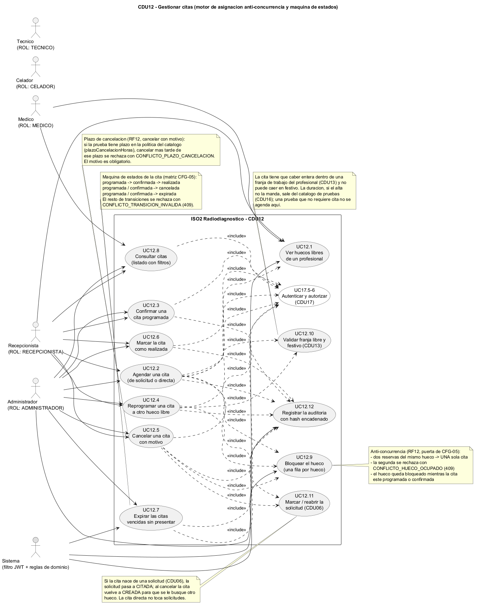
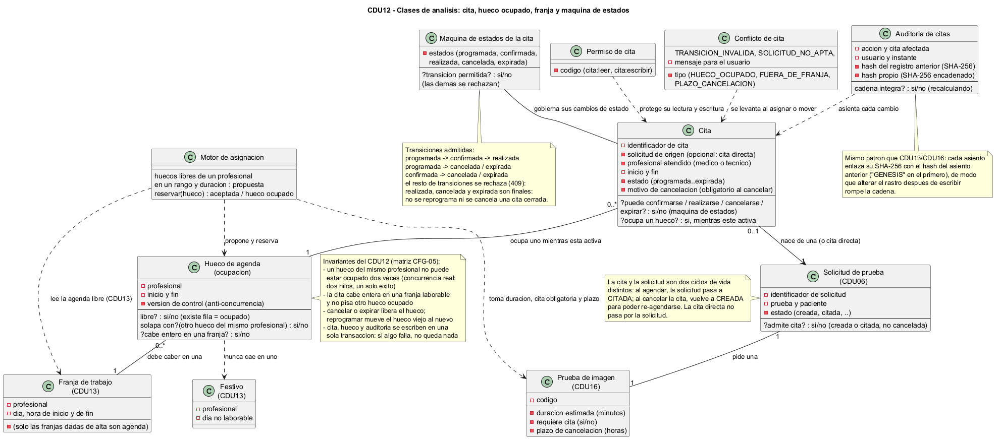
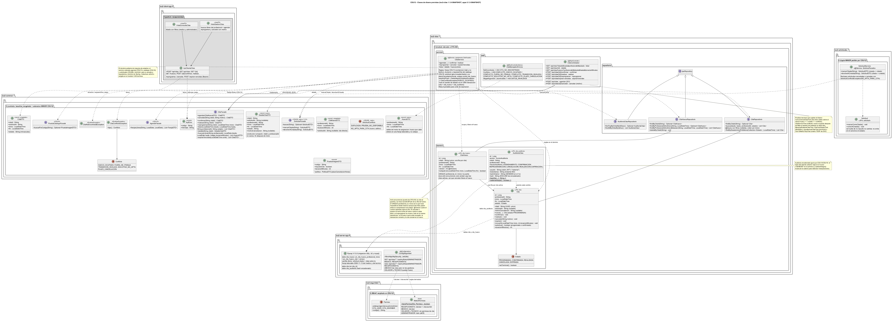
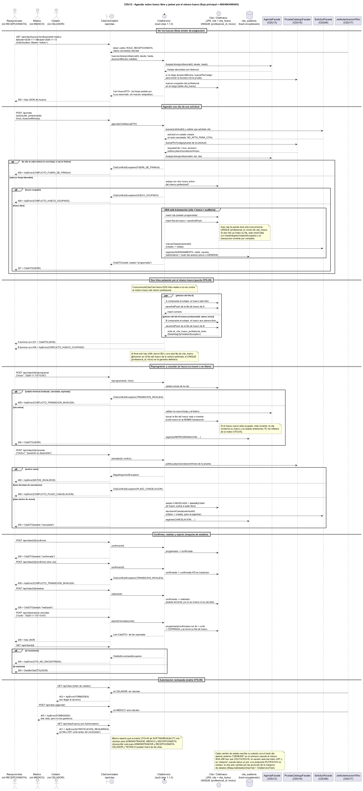

# Modelo de Iter5 / CFG-05 (D34 persistencia + CDU12 citas)

Modelo de la Iteracion 5. Reune dos partes:

1. **D34 · capa de persistencia MySQL/DAO/Agente** (issue #34): infraestructura
   prometida en la decision D34 — MySQL 8.4 en Docker con phpMyAdmin, migraciones
   Flyway dobles por carpeta (`db/migration/h2` y `db/migration/mysql`, elegidas
   por perfil activo), usuarios con privilegios separados (`gestoroperaciones`
   solo DML, `iso2_flyway` DDL) y una capa nueva de acceso JDBC (`Agente` + DAO)
   en `iso2-server-app`, manteniendo JPA como acceso primario de los modulos de
   dominio.
2. **CDU12 · Gestionar citas** (issue #40): sus cuatro diagramas `cdu12-*.puml`
   (casos de uso, clases de analisis, clases de diseno y secuencia), commiteados
   antes de escribir codigo Java de CDU12 (design-primero, D31). Cubren el motor
   de asignacion sobre huecos libres con anti-concurrencia, la maquina de estados
   de la cita, la liberacion del hueco al cancelar y el ripple MINOR sobre
   `iso2-solicitudes`.

> **Design-primero** (D31): los `.puml` de este directorio se commitean ANTES del
> codigo Java que describen y actuan de contrato interno (paquetes, firmas,
> rutas HTTP y reglas). Si un test tecnico o un TC humano (D28) obliga a cambiar
> una firma, se edita primero el `.puml` y se commitea junto al cambio. Los `.png`
> incrustados se renderizan con `tools/plantuml.jar`.

## Fuentes PlantUML (lo que versiona el proyecto)

| Fichero | Que modela |
| --- | --- |
| `persistencia-clases-diseno.puml` | Capa nueva `es.uclm.iso2.server.persistencia`: patron Agente (H2/MySQL), DAO JDBC, controlador de diagnostico y regla de seguridad; convive con los repositorios JPA existentes |
| `persistencia-secuencia.puml` | Arranque con Flyway por perfil (carpeta h2 o mysql) y flujo del `GET /api/persistencia/diagnostico` (200 ADMIN / 403 resto) |
| `cdu12-casos-uso.puml` | Casos de uso de CDU12: ver huecos libres (UC12.1), agendar de solicitud o directa (UC12.2), confirmar (UC12.3), reprogramar (UC12.4), cancelar con motivo (UC12.5), realizar (UC12.6), expirar vencidas (UC12.7) y listar (UC12.8), con `<<include>>` del bloqueo de hueco (UC12.9), de la validacion de franja y festivo CDU13 (UC12.10), del marcar/reabrir solicitud CDU06 (UC12.11), de la auditoria con hash encadenado (UC12.12) y de la autenticacion/autorizacion CDU17 |
| `cdu12-clases-analisis.puml` | Conceptos del dominio: cita (con estado y motivo de cancelacion), hueco de agenda con version de control, franja y festivo de CDU13, solicitud de CDU06, prueba de CDU16 (duracion, `requiereCita`, plazo de cancelacion), motor de asignacion, maquina de estados, conflicto y auditoria encadenada; invariantes del CDU |
| `cdu12-clases-diseno.puml` | Implementacion prevista: `CitaFacade` 1.1.0 (baseline congelado `agendar`/`cancelar` + metodos MINOR `confirmar`/`realizar`/`reprogramar`/`listar`/`detalle`/`huecosLibres`/`expirarVencidas` y los records nuevos `DetalleCitaDTO` y `HuecoDTO`), `iso2-citas` 1.1.0-SNAPSHOT (dominio con `Cita`/`Estado`/`CitaHueco` con `@Version`/`AuditoriaCitas`, repositorios, servicio y capa web), el ripple `SolicitudFacade.marcarCitada`/`devolverACreada` que sube `iso2-solicitudes` a 1.2.0, el RBAC nuevo `cita:leer`/`cita:escribir`, `ConfigSeguridad` 0.1.5 y la migracion Flyway V1.5.0 |
| `cdu12-secuencia.puml` | Flujo `GET /api/citas/huecos`, `POST /api/citas` con sus ramas 409 FUERA_DE_FRANJA / 409 HUECO_OCUPADO / 201, los dos hilos reales peleando por el mismo hueco en paralelo (`par`/`else`, la puerta de CFG-05), `reprogramar` y `cancelar` con movimiento o liberacion del hueco y reapertura de la solicitud, confirmar/realizar/expirar con su 409 TRANSICION_INVALIDA, el 404 de detalle y los 403/401 de la matriz |

Convencion de las fuentes: ASCII puro en comentarios y etiquetas de PlantUML (sin
tildes: se escriben "diseno", "autenticacion", etc.) para que no haya ambiguedad
de codificacion; UTF-8 para el resto de documentos.

## Como renderizar

```powershell
java -DPLANTUML_LIMIT_SIZE=16384 -jar tools/plantuml.jar -tpng docs/modelo/iter05/cdu12-*.puml
```

Dos detalles que importan:

- Sin Graphviz hay que anadir `-Playout smetana`.
- El limite por defecto de PlantUML es de **4096 px de lado** y recorta la imagen
  sin error ruidoso. `cdu12-clases-diseno.png` (7485 px de ancho) y
  `cdu12-secuencia.png` (4497 px de alto) lo superan, por eso el comando lleva
  `-DPLANTUML_LIMIT_SIZE=16384`. Tambien se re-renderizo con ese flag
  `docs/modelo/iter04/cdu06-clases-diseno.png`, que estaba versionado recortado a
  4096 px (le faltaban los paquetes de la derecha: solicitudes, server-app,
  seguridad y cliente).

## Diagramas

### D34 · Clases de diseno de la capa de persistencia


Decisiones de diseno que fija este diagrama:

- **JPA sigue siendo el acceso primario** de catalogo/seguridad/agendas/solicitudes;
  la capa DAO+Agente es una incorporacion nueva que no sustituye nada (decision
  tomada el 08/11/2026 y registrada en DECISIONS.md).
- **`Agente` es el unico punto que conoce el SGBD**: `ConfigPersistencia` elige
  `AgenteH2` o `AgenteMySQL` segun `DatabaseMetaData.getDatabaseProductName()`
  del `DataSource` compartido; no hay dos datasources.
- **`DiagnosticoPersistenciaDao` es el primer DAO JDBC** (patron DAO): solo SQL
  portatil sobre `INFORMATION_SCHEMA`, sin escritura de esquema. Sirve para
  demostrar el patron y para pruebas Testcontainers contra MySQL real.
- **Privilegios separados (D34)**: la aplicacion entra con `gestoroperaciones`
  (solo DML); el esquema solo lo versiona Flyway con `iso2_flyway` (DDL).
- **El diagnostico es solo de administrador**: `/api/persistencia/**` pasa a
  `hasRole("ADMINISTRADOR")` en `ConfigSeguridad` (el SGBD y su tamano son
  informacion operativa sensible).

### D34 · Secuencia del diagnostico de persistencia


Codigos fijados: `200` con `DiagnosticoSgbD` para ADMINISTRADOR; `401` sin JWT;
`403` con rol que no es ADMINISTRADOR.

---

### CDU12 · Casos de uso (clic sobre la imagen para abrirla a tamano completo)

<a href="cdu12-casos-uso.png"></a>

- Dos entradas al agendamiento: **cita nacida de una solicitud** (CDU06) y
  **cita directa** (sin solicitud). La diferencia solo afecta al estado de la
  solicitud, no a la cita.
- Toda accion de cita pasa por CDU17 (`<<include>>`), y toda escritura deja un
  asiento de auditoria con hash encadenado (UC12.12, mismo patron que CDU13/CDU16).
- El hueco queda **bloqueado mientras la cita este activa** (programada o
  confirmada); cancelar, realizar o expirar lo libera.
- El plazo de cancelacion sale de la politica de la prueba en el catalogo
  (`PoliticaDTO.plazoCancelacionHoras`), y el motivo es obligatorio.

### CDU12 · Clases de analisis

<a href="cdu12-clases-analisis.png"></a>

- **Cita y hueco son conceptos distintos**: la cita es el compromiso asistencial
  con su ciclo de vida; el hueco es la ocupacion del tiempo de un profesional.
  Mientras la cita esta activa ocupa un hueco, y al cerrarse ese hueco desaparece.
- La **maquina de estados** gobierna los cambios: `programada -> confirmada ->
  realizada`, y `programada`/`confirmada` tambien pueden acabar en `cancelada` o
  `expirada`. `realizada`, `cancelada` y `expirada` son estados finales.
- El **conflicto de cita** traduce los motivos de rechazo (hueco ocupado, fuera de
  franja, transicion invalida, solicitud no apta, fuera de plazo) a codigos HTTP
  estables.
- La **auditoria enlazada** permite demostrar que el rastro no se manipulo
  despues de escribirlo.

### CDU12 · Clases de diseno

<a href="cdu12-clases-diseno.png"></a>

Las decisiones que fija este diagrama (y que luego sujetan los tests):

- **El contrato `CitaFacade` se extiende en MINOR**: el baseline 1.0.0
  (`agendar(CitaNuevaDTO)` y `cancelar(citaId, motivo)` con sus records) queda
  congelado e intocado; se anaden `confirmar`, `realizar`, `reprogramar`,
  `listar`, `detalle`, `huecosLibres` y `expirarVencidas` mas dos records nuevos
  (`DetalleCitaDTO`, `HuecoDTO`). El modulo `iso2-citas` pasa de baseline 1.0.0 a
  1.1.0-SNAPSHOT (CFG-05).
- **Anti-concurrencia por clave unica, no por comprobacion**: la tabla
  `cita_hueco` guarda **una fila por cita activa** con
  `UNIQUE (profesional_id, inicio)` y `@Version` en la fila (SOFTWAREQUALITY.md
  §CDU12 exige `@Version` en el hueco). El servicio comprueba el solape, pero la
  garantia la da el `saveAndFlush`: si otro hilo habia insertado antes, salta
  `DataIntegrityViolationException` y se traduce a 409 `CONFLICTO_HUECO_OCUPADO`.
  Por eso el hueco no esta en la propia fila de `cita`: al cancelar se borra la
  fila del hueco y la cita cancelada conserva su historial.
- **Una sola transaccion** escribe cita + `cita_hueco` + `cita_auditoria` (y el
  cambio de estado de la solicitud). Es lo que comprueba el TC de rollback de la
  matriz CFG-05: si algo falla, no queda cita ni hueco reservado.
- **Frontera con CDU13, CDU16 y CDU06**: las franjas y festivos se piden a
  `AgendaFacade.franjasLibres` (que no descuenta lo ya reservado: el CDU12 parte
  la franja contra `cita_hueco`); la duracion, `requiereCita` y el plazo de
  cancelacion salen de `PruebaCatalogoFacade`; el estado de la solicitud se
  cambia con `SolicitudFacade.marcarCitada` / `devolverACreada`.
- **Ripple MINOR sobre `iso2-solicitudes`**: ese modulo sube a 1.2.0-SNAPSHOT
  porque la fachada gana dos metodos y el enum de conflictos un valor aditivo
  (`NO_APTA_PARA_CITA`). Sin ese cambio CDU12 no puede dejar la solicitud en
  `citada` ni reabrirla al cancelar.
- **RBAC nuevo**: `cita:leer` para ADMINISTRADOR/MEDICO/RECEPCIONISTA y
  `cita:escribir` solo para ADMINISTRADOR/RECEPCIONISTA (CELADOR y TECNICO fuera).
  El MEDICO lee citas pero no las gestiona.
- **JaCoCo del modulo** elevado a `0.80` de linea (puerta de CFG-05) y ArchUnit
  (`ArquitecturaCitasTest`) con las mismas fronteras que CDU06/CDU13.

### CDU12 · Secuencia

<a href="cdu12-secuencia.png"></a>

Codigos fijados: `201` al agendar, `200` en confirmar/realizar/reprogramar/
cancelar/listar/detalle/huecos, `404 CITA_NO_ENCONTRADA`,
`409 CONFLICTO_HUECO_OCUPADO` / `CONFLICTO_FUERA_DE_FRANJA` /
`CONFLICTO_TRANSICION_INVALIDA` / `CONFLICTO_SOLICITUD_NO_APTA` /
`CONFLICTO_PLAZO_CANCELACION`, `400 DATOS_INVALIDOS`, `403 FORBIDDEN` y `401
AUTENTICACION_REQUERIDA`. El bloque `par`/`else` de "dos hilos peleando por el
mismo hueco" es la representacion del TC de concurrencia de la matriz CFG-05.

## Relacion con el codigo (CDU12)

El diagrama de diseno describe el codigo **aun por implementar** en la parte
servidora de CDU12. Lo que se compromete a construir:

- `iso2-common` 1.1.0-SNAPSHOT: `es.uclm.iso2.common.citas.CitaFacade` con la
  extension MINOR descrita, `CitaNoEncontradaException` y
  `CitaConflictoException` (enum anidado `Conflicto`).
- `iso2-citas` 1.1.0-SNAPSHOT (elevado de baseline a CDU en CFG-05, D23): dominio
  (`Cita` con enum anidado `Estado`, `CitaHueco` con `@Version`,
  `AuditoriaCitas` con hash encadenado), repositorios, `CitaServicio` (reloj
  inyectable para el corte de expiracion, reglas de franja/catalogo/solicitud y
  la puerta unica anti-concurrencia) y capa web (`CitaControlador` en
  `/api/citas` + `CitaManejadorErrores`).
- `iso2-solicitudes` 1.2.0-SNAPSHOT: `marcarCitada`/`devolverACreada` en la
  fachada y en la entidad, mas el valor aditivo `NO_APTA_PARA_CITA`.
- `iso2-seguridad` 1.1.0-SNAPSHOT: `Permiso.CITA_LEER` y `CITA_ESCRIBIR` con sus
  concesiones en `MatrizPermisos`.
- `iso2-server-app` 0.1.5-SNAPSHOT: reglas de `/api/citas/**` en `ConfigSeguridad`
  y `V1.5.0__cdu12_citas.sql` en las dos carpetas (`h2` y `mysql`) con las tablas
  `cita`, `cita_hueco` (con sus claves unicas y `version`) y `cita_auditoria`, mas
  la semilla demo de citas sobre las franjas laborables sembradas en V1.3.0 para
  que los TC humanos (D28) tengan huecos donde pinchar.
- `iso2-client-app` 0.1.5-SNAPSHOT (parte b): `ApiClienteCitas` y las vistas
  JavaFX de recepcionista (huecos libres + agendar/reprogramar/cancelar) y de
  consulta para medico y administrador.

Tests tecnicos previstos de esta CDU: `ConcurrenciaCitasTest` (dos hilos reales
sobre el mismo hueco -> 1 creado + 1 conflicto), `CitaServicioTest` (rollback de
cita + hueco + auditoria), `MaquinaEstadosCitasTest` (transiciones validas e
invalidas), `CitaControladorTest` (MockMvc), `ArquitecturaCitasTest` (frontera
ArchUnit de CFG-05), `Cdu12MatrizTdopTest` (matriz TDOP de D33) y
`CitasApiTest` en `iso2-server-app` (gate HTTP con RBAC). Los TC funcionales
humanos de CDU12 los ejecuta Ismael (D28) contra la semilla de desarrollo.

Si el codigo cambia tras los TC humanos de CDU12 (D28), actualizar primero el
`.puml` y volver a renderizar el `.png` con `tools/plantuml.jar`.
