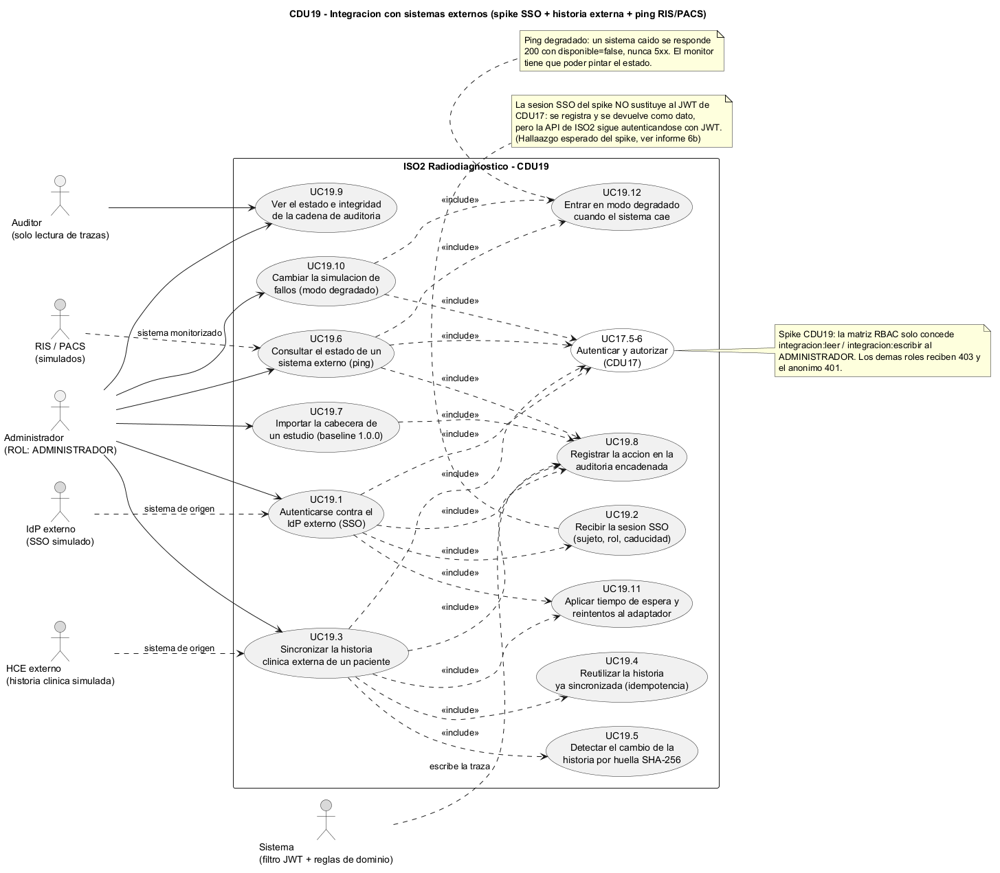
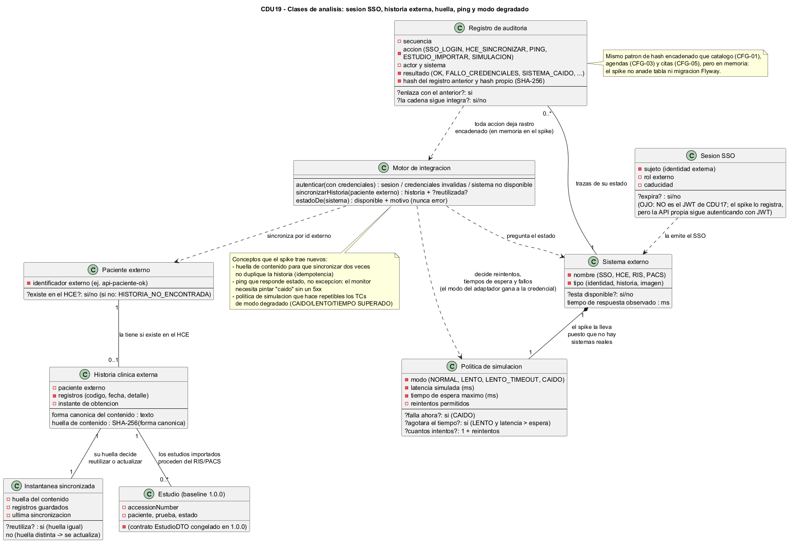
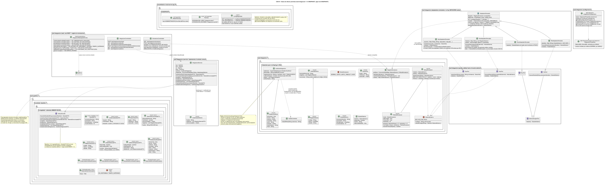
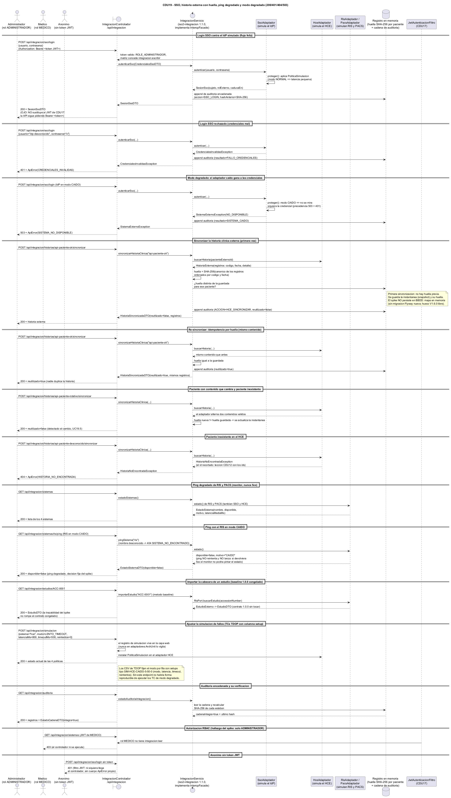

# Modelo de Iter6 / CFG-06 (CDU19 integraciones — spike)

Modelo de la Iteracion 6: **CDU19 · Integracion con sistemas externos** (issue #44).
Cuatro diagramas `cdu19-*.puml` (casos de uso, clases de analisis, clases de diseno y
secuencia), commiteados **antes** de escribir codigo Java de CDU19 (design-primero, D31).

El alcance de esta CDU en develop es un **spike de integraciones**: como no hay IdP,
HCE ni RIS/PACS reales contra los que pinchar, el modulo `iso2-integracion` simula los
cuatro sistemas externos con una **politica de simulacion mutable** (modo, latencia,
tiempo de espera y reintentos) para poder ejecutar los TCs de modo degradado
(CAIDO/LENTO/TIEMPO SUPERADO) y la idempotencia de la sincronizacion. El informe
`docs/informes/spike-cdu19.md` (sesion 6b) recoge los hallazgos.

> **Design-primero** (D31): los `.puml` de este directorio se commitean ANTES del
> codigo Java que describen y actuan de contrato interno (paquetes, firmas,
> rutas HTTP y reglas). Si un test tecnico o un TC humano (D28) obliga a cambiar
> una firma, se edita primero el `.puml` y se commitea junto al cambio. Los `.png`
> incrustados se renderizan con `tools/plantuml.jar`.

## Fuentes PlantUML (lo que versiona el proyecto)

| Fichero | Que modela |
| --- | --- |
| `cdu19-casos-uso.puml` | Casos de uso de CDU19: login SSO contra el IdP (UC19.1/UC19.2), sincronizar la historia externa (UC19.3) con reutilizacion idempotente (UC19.4) y deteccion de cambio por huella (UC19.5), ping de un sistema (UC19.6), importar la cabecera de estudio del baseline (UC19.7), auditoria encadenada (UC19.8/UC19.9), cambio de simulacion (UC19.10), tiempos de espera y reintentos (UC19.11) y modo degradado (UC19.12), todos con `<<include>>` de CDU17 |
| `cdu19-clases-analisis.puml` | Conceptos del dominio: sistema externo con su politica de simulacion, sesion SSO (que NO es el JWT de CDU17), paciente externo, historia clinica externa con huella SHA-256, instantanea sincronizada (reutilizar o actualizar), estudio del baseline 1.0.0, registro de auditoria enlazado y motor de integracion |
| `cdu19-clases-diseno.puml` | Implementacion prevista: `InteropFacade` 1.1.0 (baseline 1.0.0 `importarEstudio`/`EstudioDTO` congelado + metodos MINOR `autenticarSso`/`sincronizarHistoriaClinica`/`pingRis`/`pingPacs`/`pingSistema`/`estadoSistemas`/`estadoAuditoriaIntegracion` con sus records y excepciones nuevos), `iso2-integracion` 1.1.0-SNAPSHOT en cinco capas (`dominio` puro, `puerto`, `adaptador`, `servicio`, `web`, `configuracion`) con `AuditoriaIntegracion` **en memoria** (sin Flyway), adaptadores simulados compartiendo el `RegistroSimulacion` del dominio, `IntegracionControlador` + `IntegracionManejadorErrores` y el ensamblado RBAC (`integracion:leer`/`integracion:escribir` solo ADMINISTRADOR) en `iso2-server-app` 0.2.0-SNAPSHOT |
| `cdu19-secuencia.puml` | Flujos reales de los TCs: login SSO feliz y 401 `CREDENCIALES_INVALIDAS`, IdP CAIDO ganando a la credencial (503 antes que 401), primera sincronizacion y re-sincronizacion `reutilizado=true`, paciente rotativo (huella nueva) y desconocido (404 `HISTORIA_NO_ENCONTRADA`), ping degradado que responde 200 con `disponible=false` (nunca 5xx), importar estudio del baseline, `POST /api/integracion/simulacion` con el token de setup de los CSV TDOP, ver la cadena de auditoria y los 403/401 de la matriz |

Convencion de las fuentes: ASCII puro en comentarios y etiquetas de PlantUML (sin
tildes: se escriben "diseno", "autenticacion", etc.) para que no haya ambiguedad
de codificacion; UTF-8 para el resto de documentos.

## Como renderizar

```powershell
java -DPLANTUML_LIMIT_SIZE=16384 -jar tools/plantuml.jar -tpng docs/modelo/iter06/cdu19-*.puml
```

Dos detalles que importan:

- Sin Graphviz hay que anadir `-Playout smetana`.
- El limite por defecto de PlantUML es de **4096 px de lado** y recorta la imagen
  sin error ruidoso, por eso el comando lleva `-DPLANTUML_LIMIT_SIZE=16384`
  (ya paso en iter05 con `cdu12-clases-diseno.png`).

## Diagramas

### CDU19 · Casos de uso (clic sobre la imagen para abrirla a tamano completo)

<a href="cdu19-casos-uso.png"></a>

- La matriz RBAC del spike concede `integracion:leer` y `integracion:escribir`
  **solo al ADMINISTRADOR**: los demas roles reciben 403 y el anonimo 401.
- La sesion SSO que devuelve el IdP simulado **no sustituye al JWT de CDU17**: la
  API propia sigue autenticandose con Bearer. Es un hallazgo del spike (informe 6b).
- El ping de un sistema caido se modela como caso de uso que **acaba en estado
  pintado** (`disponible=false`), no en error: el monitor necesita 200.

### CDU19 · Clases de analisis

<a href="cdu19-clases-analisis.png"></a>

- **Historia externa y huella**: la huella SHA-256 de la forma canonica del contenido
  es lo que decide si sincronizar vuelve a traer datos o reutiliza la instantanea.
  Sin huella, repetir la sincronizacion duplicaria la historia (TC de idempotencia).
- **Politica de simulacion como concepto de dominio**: es lo que hace repetibles los
  TCs de modo degradado; los CSV de TDOP la fijan por fila con setups tipo
  `SIM-HCE-CAIDO-5-50-0`.
- **Auditoria encadenada otra vez**: mismo patron de hash que catalogo (CFG-01),
  agendas (CFG-03) y citas (CFG-05), pero en memoria: el spike no anade tabla.

### CDU19 · Clases de diseno

<a href="cdu19-clases-diseno.png"></a>

Las decisiones que fija este diagrama (y que luego sujetan los tests):

- **El contrato `InteropFacade` se extiende en MINOR**: el baseline 1.0.0
  (`importarEstudio(String)` y `EstudioDTO`) queda congelado e intocado (es la
  trazabilidad de CFG-00); se anaden `autenticarSso`, `sincronizarHistoriaClinica`,
  `pingRis`, `pingPacs`, `pingSistema`, `estadoSistemas` y
  `estadoAuditoriaIntegracion` con sus records nuevos
  (`CredencialesSsoDTO`, `SesionSsoDTO`, `HistoriaSincronizadaDTO`,
  `EstadoSistemaDTO`, `AuditoriaIntegracionDTO`) y tres excepciones nuevas.
  `iso2-common` sigue en 1.1.0-SNAPSHOT (el MINOR ya lo trajo CFG-05).
- **Puertos y adaptadores**: `SsoPort`, `HcePort` y `SistemaImagenPort`
  (con `RisPort`/`PacsPort` por debajo) son la frontera; los adaptadores simulados
  la implementan. Si manana hay un IdP real, se sustituye el adaptador sin tocar
  servicio ni contrato.
- **Precedencia 503 > 401**: si el adaptador esta CAIDO, la credencial ni se mira.
  El fallo del sistema externo gana al de las credenciales del usuario.
- **Ping degradado**: `pingRis`/`pingPacs` no lanzan excepcion; devuelven
  `EstadoSistema(disponible=false, motivo)` y el controlador responde 200. El login
  y la sincronizacion SI propagan 503 (`SISTEMA_NO_DISPONIBLE` /
  `SISTEMA_TIEMPO_SUPERADO`).
- **Auditoria en memoria**: `AuditoriaIntegracion` reutiliza el patron hash-chain
  de `AuditoriaCitas` pero sin JPA ni migracion nueva (el hueco V1.6.0 queda libre
  para el CDU19 "de verdad" del backlog).
- **Frontera ArchUnit** (`ArquitecturaIntegracionTest`): `dominio` puro sin Spring
  ni JPA; `servicio` solo conoce puertos y dominio; `web` solo conoce el contrato
  `InteropFacade` y el `RegistroSimulacion` del dominio (jamas `adaptador`);
  `common` jamas mira hacia el modulo.
- **RBAC y ensamblado**: `Permiso.INTEGRACION_LEER`/`INTEGRACION_ESCRIBIR` solo para
  ADMINISTRADOR, reglas en `ConfigSeguridad`, pin del modulo en el pom de
  `iso2-server-app` y defaults `iso2.integracion.*` en el `application.yml`
  principal **y** en el de test (el de test sombreada al principal).

### CDU19 · Secuencia

<a href="cdu19-secuencia.png"></a>

Codigos fijados: `200` (login, sincronizar, ping degradado, estudios, auditoria,
simulacion), `401 CREDENCIALES_INVALIDAS`, `404 HISTORIA_NO_ENCONTRADA` /
`ESTUDIO_NO_ENCONTRADO` / `SISTEMA_NO_ENCONTRADO`, `400 DATOS_INVALIDOS`,
`415 CONTENIDO_NO_ACEPTADO` (D35), `503 SISTEMA_NO_DISPONIBLE` /
`SISTEMA_TIEMPO_SUPERADO`, `403` por matriz y `401` anonimo por el filtro JWT.

## Relacion con el codigo (CDU19)

El diagrama de diseno describe el codigo **aun por implementar** en esta rama
(`feature/iter06-cdu19-integracion`). Lo que se compromete a construir:

- `iso2-common` 1.1.0-SNAPSHOT: `InteropFacade` con la extension MINOR descrita y
  las excepciones `CredencialesInvalidasException`, `HistoriaNoEncontradaException`,
  `EstudioNoEncontradoException`, `SistemaNoEncontradoException` y
  `SistemaExternoException` (enum anidado `Fallo`).
- `iso2-integracion` 1.1.0-SNAPSHOT (elevado de baseline a CDU en CFG-06, D23):
  dominio puro, puertos, adaptadores simulados, `IntegracionServicio` y capa web con
  `IntegracionControlador` + `IntegracionManejadorErrores`; puerta JaCoCo de linea
  `0.70` (el spike simula: no hay reglas de negocio de agenda que cubrir).
- `iso2-seguridad`: `Permiso.INTEGRACION_LEER`/`INTEGRACION_ESCRIBIR` en la matriz.
- `iso2-server-app` 0.2.0-SNAPSHOT: reglas `/api/integracion/**` en
  `ConfigSeguridad`, pin del modulo en el pom y defaults `iso2.integracion` en los
  dos `application.yml`. **Sin migracion Flyway**: el spike no persiste.
- Nada en `iso2-client-app` en develop: la pantalla del monitor se queda para la
  linea 1.1.0 de `release/R1` junto al CDU19 real (mapa de configuraciones).

Tests tecnicos previstos: `IntegracionServicioTest` (huella e idempotencia,
precedencia 503>401, cadena de auditoria), `AdaptadorSimuladoTest` (modos,
reintentos y tiempo superado con reloj real pequeno), `IntegracionControladorTest`
(MockMvc), `ArquitecturaIntegracionTest` (frontera ArchUnit de CFG-06),
`Cdu19MatrizTdopTest` (matriz TDOP de D33 leiendo los CSV generados por
`tools/pairwise.py`) y `IntegracionApiTest` en `iso2-server-app` (gate HTTP con
RBAC de los 5 roles + anonimo). Los TC funcionales humanos de CDU19 los ejecuta
Ismael (D28) contra el servidor en marcha.

Si el codigo cambia tras los TC humanos de CDU19 (D28), actualizar primero el
`.puml` y volver a renderizar el `.png` con `tools/plantuml.jar`.
