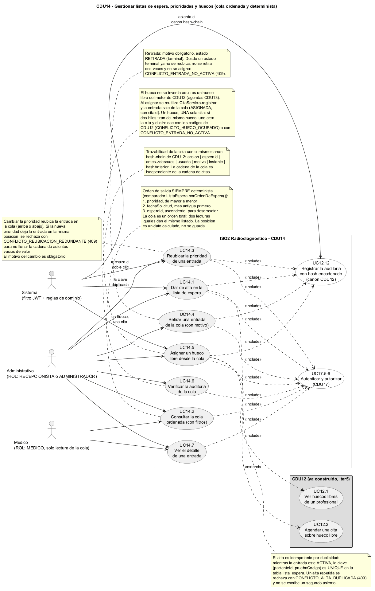
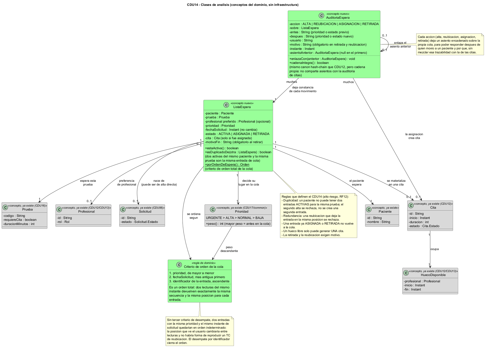
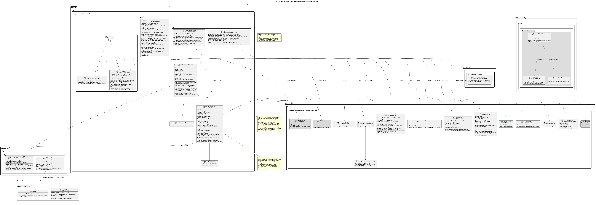
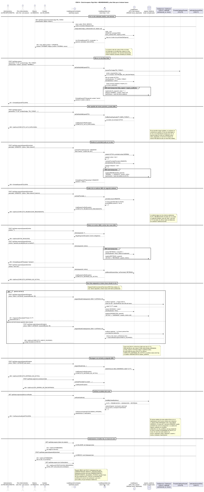

# Modelo de Iter7 / CDU14 (Gestionar listas de espera, prioridades y huecos)

Modelo de la Iteracion 7: **CDU14 · Gestionar listas de espera, prioridades y huecos**
(issue #47). Cuatro diagramas `cdu14-*.puml` (casos de uso, clases de analisis, clases
de diseno y secuencia), commiteados **antes** de escribir codigo Java de CDU14
(design-primero, D31).

El CDU14 anade al sistema una **cola de espera por prueba** para los pacientes que
 esperan un hueco: el alta registra la solicitud en la cola con una prioridad, la cola
 se lee siempre en el **mismo orden determinista**, la prioridad se puede reubicar con
 autor y motivo, y cuando aparece un hueco libre la entrada se convierte en cita. El
 CDU14 **no inventa huecos**: reutiliza el motor anti-concurrencia de CDU12
 (`CitaServicio.registrar`, agendas de CDU13 y `cita_hueco` con su UNIQUE). Por eso la
 parte delicada del CDU14 no es crear la cita, que ya esta probada, sino **el orden de
 la cola, el duplicado en el alta, la reubicacion redundante del doble clic y que un
 hueco siga significando una sola cita** cuando dos hilos tiran de la misma cola.
No hay vista de cliente en esta iteracion: la pantalla de la cola queda diferida, el
alcance modelado es dominio + servicio + REST + Flyway + RBAC.

> **Design-primero** (D31): los `.puml` de este directorio se commitean ANTES del
> codigo Java que describen y actuan de contrato interno (paquetes, firmas,
> rutas HTTP y reglas). Si un test tecnico o un TC humano (D28) obliga a cambiar
> una firma, se edita primero el `.puml` y se commitea junto al cambio. Los `.png`
> incrustados se renderizan con `tools/plantuml.jar`.

## Fuentes PlantUML (lo que versiona el proyecto)

| Fichero | Que modela |
| --- | --- |
| `cdu14-casos-uso.puml` | Casos de uso de CDU14: dar de alta en la cola (UC14.1), consultar la cola ordenada con filtros (UC14.2), reubicar la prioridad (UC14.3), retirar con motivo (UC14.4), asignar un hueco desde la cola (UC14.5), verificar la auditoria de la cola (UC14.6) y ver el detalle de una entrada (UC14.7), con `<<include>>` de CDU17 (autenticar y autorizar) y del canon de auditoria hash-chain de CDU12, y `<<extend>>` de UC12.2 (agendar sobre hueco libre). Actores: Administrativo (RECEPCIONISTA o ADMINISTRADOR), Medico solo lectura y el Sistema como ejecutor de las reglas duras |
| `cdu14-clases-analisis.puml` | Conceptos del dominio, sin infraestructura: `ListaEspera` (paciente, prueba, profesional opcional, prioridad, fechaSolicitud y estado ACTIVA/ASIGNADA/RETIRADA), `AuditoriaEspera` como traza encadenada de la cola, el **criterio de orden de la cola** como regla de dominio con tres niveles, y los conceptos ya existentes reutilizados (Paciente, Prueba de CDU16, Profesional, Solicitud de CDU06, Cita y HuecoDisponible de CDU12/CDU13, Prioridad de `iso2-common`), con las reglas de duplicidad, redundancia, no reentrada y un hueco = una cita |
| `cdu14-clases-diseno.puml` | Implementacion prevista: `ListaEsperaFacade` en `iso2-common` 1.1.0 con sus records nuevos (`AltaEsperaDTO`, `EntradaEsperaDTO` con `posicion` y `total`, `ReubicacionDTO`, `AsignacionEsperaDTO`, `RetiradaEsperaDTO`, `AsignacionResultadoDTO`, `VerificacionAuditoriaDTO`) y dos excepciones nuevas; en `iso2-citas` 1.2.0-SNAPSHOT la entidad `ListaEspera` (tabla `lista_espera`, `claveDuplicada` UNIQUE con NULL en terminal) con `{static} porOrdenDeEspera()`, `AuditoriaEspera` (tabla `espera_auditoria`), `ListaEsperaRepositorio` y `AuditoriaEsperaRepositorio`, `ListaEsperaServicio` (`cambiarPrioridad(esperaId, prioridad, motivo, usuario)`, `asignarDesdeCola(esperaId, inicio, duracionMinutos)`), `ListaEsperaControlador` + `ListaEsperaManejadorErrores`, el bloque gris de CDU12 que se reutiliza sin tocar, `ConfigSeguridad` y Flyway `V1.6.0` en `iso2-server-app` 0.3.0-SNAPSHOT y los permisos `listaespera:leer`/`listaespera:escribir` en `iso2-seguridad` |
| `cdu14-secuencia.puml` | Flujos reales de los TCs: ver la cola (medico, 200 con posicion 1..n), alta feliz (201 con `posicion` y `total`), alta repetida (409 `CONFLICTO_ALTA_DUPLICADA`, sin eslabon nuevo), reubicacion feliz (200 con posicion antes/despues), doble clic en reubicar (409 `CONFLICTO_REUBICACION_REDUNDANTE` y cadena sin cambios), retirar sin motivo (400 `DATOS_INVALIDOS`) y retirar dos veces (409 `CONFLICTO_ENTRADA_NO_ACTIVA`), **dos hilos asignando el mismo hueco desde la cola** (par: 201 con una cita + 409 `CONFLICTO_HUECO_OCUPADO` heredado de CDU12, y al final 1 cita, 1 fila de `cita_hueco` y 1 eslabon `ASIGNACION`), reasignar una entrada ya asignada (409), id inexistente (404 `LISTA_ESPERA_NO_ENCONTRADA`), `GET /api/listas-espera/auditoria-verificable` con la cadena integra, y los 403/401 de la matriz RBAC |

Convencion de las fuentes: ASCII puro en comentarios y etiquetas de PlantUML (sin
tildes: se escriben "diseno", "autenticacion", etc.) para que no haya ambiguedad
de codificacion; UTF-8 para el resto de documentos.

## Como renderizar

```powershell
java -DPLANTUML_LIMIT_SIZE=16384 -jar tools/plantuml.jar -tpng docs/modelo/iter07/cdu14-*.puml
```

Dos detalles que importan:

- Sin Graphviz hay que anadir `-Playout smetana`.
- El limite por defecto de PlantUML es de **4096 px de lado** y recorta la imagen
  sin error ruidoso, por eso el comando lleva `-DPLANTUML_LIMIT_SIZE=16384`
  (ya paso en iter05 con `cdu12-clases-diseno.png` y en esta iteracion
  `cdu14-clases-diseno.png` mide 7971x2687).

## Diagramas

### CDU14 · Casos de uso (clic sobre la imagen para abrirla a tamano completo)

<a href="cdu14-casos-uso.png"></a>

- Solo dos actores humanos: el **Administrativo** (RECEPCIONISTA o ADMINISTRADOR) hace
  toda la gestion de la cola y el **Medico** es lector (ve la cola y el detalle, no la
  mueve). CELADOR y TECNICO quedan fuera, igual que en CDU12.
- La cola se apoya en CDU12: UC14.5 **`<<extend>>`** a UC12.2 «agendar sobre hueco
  libre» (el hueco sale de las agendas de CDU13, aqui solo se dispara la asignacion) y
  todas las acciones escriben auditoria con el canon hash-chain de CDU12
  (`<<include>>` de UC12.12).
- El actor «Sistema» es el que hace efectivas las tres reglas duras del CDU14: la
  clave duplicada del alta, el rechazo de la reubicacion redundante y que un hueco
  siga siendo una sola cita bajo concurrencia.

### CDU14 · Clases de analisis

<a href="cdu14-clases-analisis.png"></a>

- **El orden es un concepto de dominio, no un detalle de consulta**: prioridad de mayor
  a menor, luego `fechaSolicitud` mas antigua, luego el identificador de la entrada.
  Con los tres criterios la cola es un **orden total**, asi que la posicion que ve el
  usuario es reproducible y los TC de reubicacion se pueden afirmar.
- **La posicion no es un dato**: es derivada de ordenar la cola del filtro activo y
  contar la fila. En el analisis no existe ninguna «posicion en la cola» almacenable.
- **Duplicidad y no reentrada como reglas**: mismo paciente + misma prueba no puede
  tener dos entradas ACTIVAS; una entrada ASIGNADA o RETIRADA no vuelve a la cola; y
  la reubicacion que no cambia la posicion se rechaza. Son reglas de negocio, no
  validaciones de formulario.
- **Trazabilidad propia**: `AuditoriaEspera` cuenta quien movio a un paciente y por que,
  con el mismo patron de hash de catalogo (CFG-01), agendas (CFG-03) y citas (CFG-05),
  pero sobre su propia cadena.

### CDU14 · Clases de diseno

<a href="cdu14-clases-diseno.png"></a>

Las decisiones que fija este diagrama (y que luego sujetan los tests):

- **El contrato comun se extiende en MINOR**: `ListaEsperaFacade` y sus records nuevos
  entran en `iso2-common` 1.1.0-SNAPSHOT; `CitaFacade` (CDU12) queda congelado e
  intocado. Las dos excepciones nuevas (`ListaEsperaException` para 404 y
  `ListaEsperaConflictException` con codigo para 409) siguen el patron de
  `CitaNoEncontradaException` / `CitaConflictoException`.
- **Orden determinista con tres niveles**: `ListaEspera.porOrdenDeEspera()` es
  `prioridad DESC, fechaSolicitud ASC, esperaId ASC` y `ListaEsperaRepositorio.cola`
  traslada ese mismo orden al `ORDER BY` de la consulta. Si el orden de la consulta y
  el del comparador divergieran, la `posicion` del DTO no se corresponderia con la
  fila que se pinta: es el punto por el que el CDU14 es de alto riesgo.
- **La posicion se calcula, no se guarda**: `EntradaEsperaDTO.posicion` (1-based) y
  `total` salen de ordenar y contar sobre el filtro activo. No hay columna
  `posicion` ni `orden_en_cola` en `lista_espera`: si se guardara, cualquier alta o
  reubicacion dejaria obsoletas las posiciones de las demas entradas.
- **Duplicado por clave derivada**: `claveDuplicada = pacienteId + "|" + pruebaCodigo`
  mientras la entrada esta ACTIVA y pasa a `NULL` al asignar o retirar, con UNIQUE
  sobre la columna. Es la misma tecnica ya probada en CDU12/CDU13/CDU16: el UNIQUE es
  la puerta dura, la comprobacion previa solo da el mensaje bonito.
- **Reubicacion redundante rechazada**: `cambiarPrioridad(esperaId, prioridad, motivo,
  usuario)` calcula la posicion antes y despues; si coincide,
  `CONFLICTO_REUBICACION_REDUNDANTE` (409) y **ningun eslabon nuevo** en
  `espera_auditoria`. Sin esa regla, el doble clic de recepcion llenaria la cadena de
  asientos vacios y dejaria de servir para auditoria.
- **La asignacion reutiliza CDU12**: `asignarDesdeCola(esperaId, inicio,
  duracionMinutos)` llama a `CitaFacade.registrar` en la misma transaccion
  (`lista_espera` + `espera_auditoria` + `cita` + `cita_hueco`). Los codigos
  `CONFLICTO_HUECO_OCUPADO` / `CONFLICTO_FUERA_DE_FRANJA` /
  `CONFLICTO_SOLICITUD_NO_APTA` viajan heredados, y `CONFLICTO_ENTRADA_NO_ACTIVA`
  cubre el caso en que la entrada ya salio de la cola. Al final: **un hueco, una
  cita, un eslabon de asignacion**.
- **Auditoria encadenada de la cola**: canon
  `accion|esperaId|antes->despues|usuario|motivo|instante|hashAnterior` con acciones
  `ALTA` / `REUBICACION` / `ASIGNACION` / `RETIRADA`, eslabon genesis con
  `hashAnterior` de 64 ceros y cadena **independiente** de `cita_auditoria`.
  Pendiente de cerrar al programar: el cuerpo del issue #47 habla de `GENESIS` +
  `hashAnterior` y `AuditoriaCitas` usa el literal `GENESIS` con `hashAnterior` nulo,
  asi que la decision (64 ceros o literal `GENESIS`) se toma en la fase de codigo y
  se refleja en este `.puml`.
- **RBAC y ensamblado**: `Permiso.LISTA_ESPERA_LEER` (ADMINISTRADOR, MEDICO,
  RECEPCIONISTA) y `LISTA_ESPERA_ESCRIBIR` (ADMINISTRADOR, RECEPCIONISTA) con sus
  reglas en `ConfigSeguridad`; migracion `V1.6.0__cdu14_listas_espera.sql` en `h2/`
  **y** `mysql/`. Sin PUT / PATCH: prioridad y estado solo cambian por las acciones
  de la cola, que son las que auditan.
- **Frontera ArchUnit** (`ArquitecturaCitasTest`): `dominio` sin Spring, `web` no toca
  repositorios y `iso2-common` no mira hacia el modulo. JaCoCo: la cota propia de
  `iso2-citas` (linea 0,80) no puede bajar con la cola nueva.

### CDU14 · Secuencia

<a href="cdu14-secuencia.png"></a>

Codigos fijados: `201` (alta y asignacion), `200` (cola, detalle, reubicacion,
retirada, auditoria verificable), `404 LISTA_ESPERA_NO_ENCONTRADA` /
`PRUEBA_NO_ENCONTRADA`, `409 CONFLICTO_ALTA_DUPLICADA` /
`CONFLICTO_REUBICACION_REDUNDANTE` / `CONFLICTO_ENTRADA_NO_ACTIVA` y los heredados de
CDU12 `CONFLICTO_HUECO_OCUPADO` / `CONFLICTO_FUERA_DE_FRANJA` /
`CONFLICTO_SOLICITUD_NO_APTA`, `400 DATOS_INVALIDOS`, `403` por matriz y `401`
anonimo por el filtro JWT, `500 ERROR_INTERNO` para lo demas.

## Relacion con el codigo (CDU14)

El diagrama de diseno describe el codigo **aun por implementar** (la rama de codigo
sera `feature/iter07-cdu14-listas-espera`, issue #47; este modelo vive en
`docs/iter07-modelo`). Lo que se compromete a construir:

- `iso2-common` 1.1.0-SNAPSHOT: `ListaEsperaFacade` con sus records y las excepciones
  `ListaEsperaException` y `ListaEsperaConflictException` (codigo anidado).
  Extension aditiva: el baseline de CDU12 no se toca.
- `iso2-citas` 1.2.0-SNAPSHOT (elevado de 1.1.0 por CDU14, D23): `ListaEspera`,
  `ListaEspera.Estado`, `AuditoriaEspera`, `ListaEsperaRepositorio`,
  `AuditoriaEsperaRepositorio`, `ListaEsperaServicio`, `ListaEsperaControlador` y
  `ListaEsperaManejadorErrores`. La cota propia del modulo sigue en **0,80 de linea**
  y el reactor sigue por encima de la puerta R2 (linea >= 70 %, rama >= 55 %).
- `iso2-seguridad` 1.1.0: `Permiso.LISTA_ESPERA_LEER` / `LISTA_ESPERA_ESCRIBIR` en la
  matriz y su reparto en `MatrizPermisos`.
- `iso2-server-app` 0.3.0-SNAPSHOT: reglas `/api/listas-espera/**` en
  `ConfigSeguridad` (GET para ADMINISTRADOR, MEDICO y RECEPCIONISTA; POST de alta,
  prioridad, asignar y retirar solo para ADMINISTRADOR y RECEPCIONISTA) y la
  migracion `V1.6.0__cdu14_listas_espera.sql` con `lista_espera` y `espera_auditoria`
  en `db/migration/h2/` **y** `db/migration/mysql/`, con semilla demo de entradas
  desempatadas, una asignada y una retirada.
- `iso2-client-app` 0.3.0-SNAPSHOT: **sin vista de cola** en esta iteracion; la
  pantalla se modela como diferida para cuando el contrato lleve una version estable.

Tests tecnicos previstos: `ListaEsperaOrdenTest` (dos lecturas de la misma cola
coinciden entrada por entrada y se cubren los tres niveles de empate),
`ListaEsperaDuplicadosTest` y `AltaColaConcurrenciaTest` (dos hilos, mismo paciente y
prueba: un alta y un 409), `ReubicacionRedundanteTest` (el doble clic devuelve 409 y
no anade eslabon), `RetirarColaTest`, `AsignarColaConcurrenciaTest` (dos hilos al
mismo hueco desde la cola: 1 cita, 1 fila en `cita_hueco` y un unico eslabon
`ASIGNACION`), `AuditoriaEsperaTest` (cadena verificable, alterar el motivo rompe la
cadena e independencia de `cita_auditoria`), `ListaEsperaControladorTest` (MockMvc),
`ArquitecturaCitasTest` (ArchUnit) y `Cdu14MatrizTdopTest` (matriz TDOP de D33
leiendo los CSV de `iso2-citas/src/test/resources/tdop`, generados con
`tools/pairwise.py` desde `docs/test/iter07/tdop-cdu14-espec.json`). Los TC
funcionales humanos de CDU14 los ejecuta Ismael (D28) contra el servidor en marcha.

Si el codigo cambia tras los TC humanos de CDU14 (D28), actualizar primero el
`.puml` y volver a renderizar el `.png` con `tools/plantuml.jar`.
